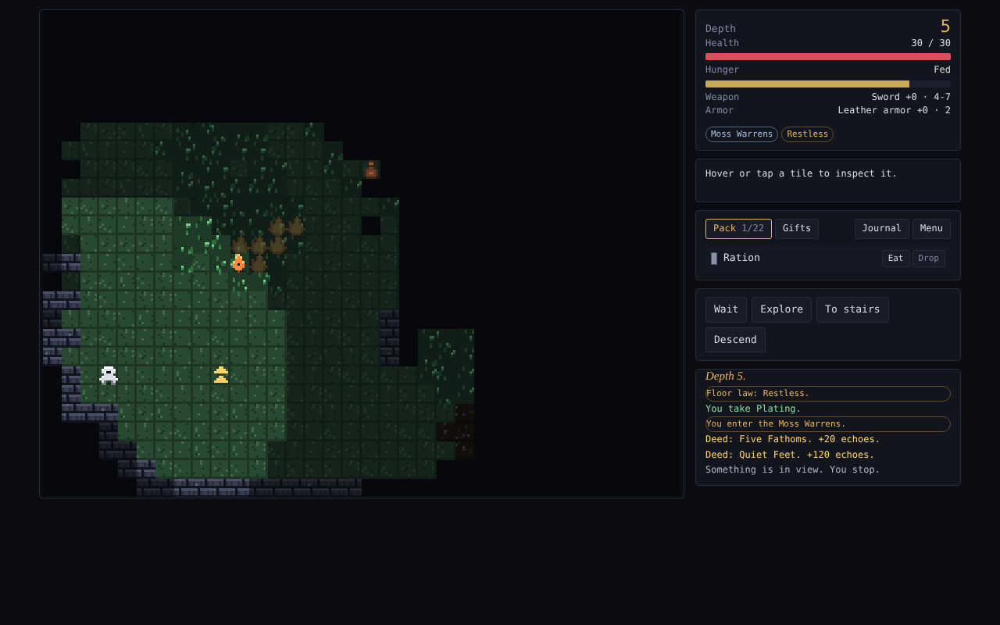
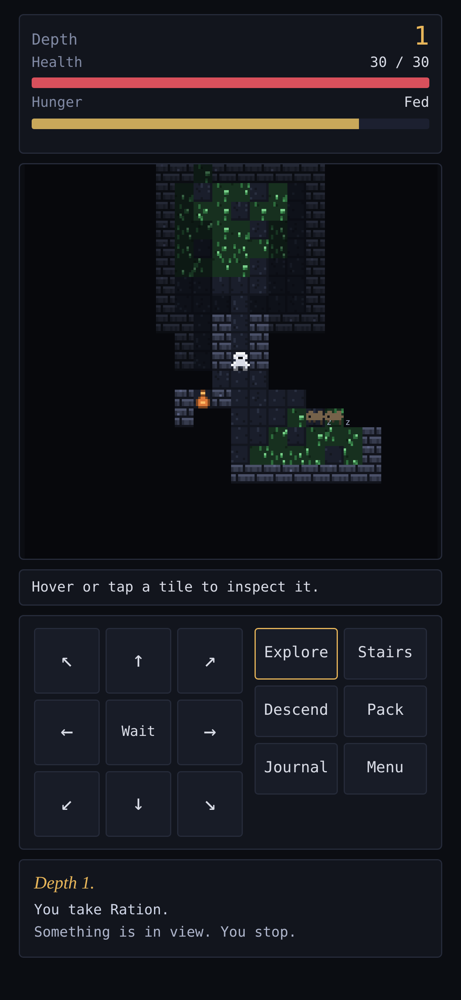

# Deepwell

An endless 8-bit roguelike about decoding a world that hides its rules.

There is no last floor. Every run drops you down a well that never ends, and the rules of that world are secret. Your journal remembers what you learn, so every death makes you a better player.

<p align="center">
  
  
</p>

## Play

- **In a browser:** after you deploy (below), the game lives at `https://<your-username>.github.io/<repo-name>/`.
- **On an iPhone or iPad:** open that link in Safari, tap Share, then **Add to Home Screen**. It runs full screen and works offline.
- **On Android:** open the link in Chrome and choose **Install app**.
- **Locally:** `npm start`, then open http://localhost:8080.

Progress saves in your browser's local storage. There are no accounts and nothing is sent anywhere.

## Controls

| Action | Keyboard | Touch |
| --- | --- | --- |
| Move or attack | Arrows, WASD, or `y u b n` for diagonals | D-pad, or tap a tile |
| Travel | Click a tile | Tap a far tile |
| Wait | Space | Wait button |
| Explore | `x` | Explore button |
| Go to the stairs | `g` | Stairs button |
| Descend | `>` or Enter | Descend button |
| Use an altar or fountain | `e` | Interact button |
| Journal | `i` | Journal button |

The pack lets you drink, read, wear, throw, mix, zap and offer items. Layout switches to the phone version automatically on small screens, and there is a toggle on the title screen.

## What to expect

Deepwell is built around discovery rather than a fixed story. It has:

- items whose true nature you must work out by experiment,
- an environment where fire, water, oil, ice and lightning interact,
- allies, curses, shrines and a growing journal,
- unlockable kits, hidden achievements, and a world that is reshuffled whenever you choose to forget everything.

This file leaves out the specifics on purpose.

## Multiplayer

Press **Multiplayer** on the title screen. One player hosts a room and shares the 5-letter code (or the invite link); everyone else joins with it. No account and no server of your own: players connect directly (WebRTC) through a free public matchmaking broker. Use **This device (other tab)** to play two windows on one computer with no network at all.

- **Co-op** (2-4 heroes): one shared dungeon, shared monsters and loot, but every hero has their own role, pack, hunger and gifts. Anyone can act at any moment and each action moves the world on. Taking the stairs brings the whole party. A fallen hero can be revived by a friend standing next to them (press **E**), or wakes at the foot of the next stairs. Ping a tile for your party with right-click (or the **Ping** button on a phone). The run ends when everyone is down.
- **Race** (2-8 players): everybody plays their own copy of the *same* dungeon at the same time: identical floors, loot and secret potion colors. A live scoreboard shows everyone's depth, kills and health. First to the goal depth wins (the host sets it), or the deepest runner when everyone has fallen.

In multiplayer every role is open and nothing found in the run touches your journal, except the echoes you earn. If a co-op player drops, they can rejoin with the same name. If the host leaves, the room closes.

Online play needs a network that allows direct peer connections; strict school or corporate networks sometimes block it.

## Development

Requires Node 18 or newer. There are no dependencies.

```bash
npm test       # rules tests (random play, every monster and item, save/load) + multiplayer tests (host and guests in separate sandboxes)
npm run build  # writes dist/ (a single index.html plus PWA files)
npm start      # build, then serve dist/ on http://localhost:8080
```

Sources live in `src/js/`. See [docs/ARCHITECTURE.md](docs/ARCHITECTURE.md) for how the pieces fit together and how to add content.

## Deploy to GitHub Pages

1. Create a repository on GitHub and push this project to its `main` branch.
2. In the repository, open **Settings → Pages** and set **Source** to **GitHub Actions**.
3. Push to `main`. The workflow in `.github/workflows/pages.yml` runs the tests, builds the game, and publishes it.

The first push to `main` creates the site. The URL appears in the workflow run and under Settings → Pages.

## License

MIT. See [LICENSE](LICENSE).
